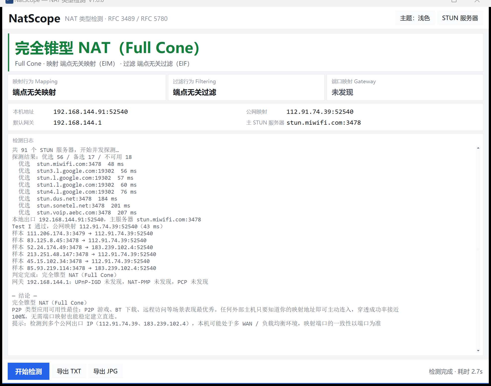
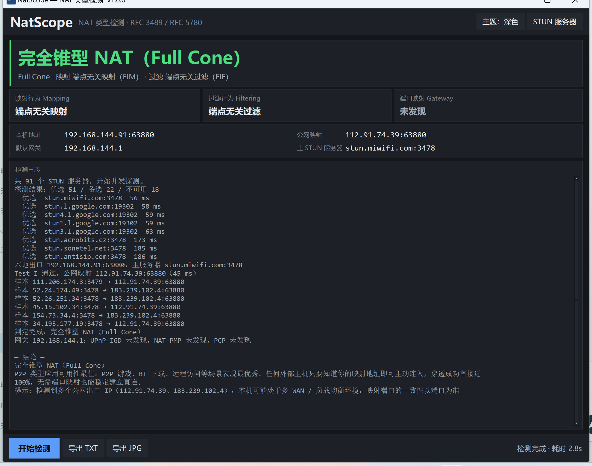

<div align="center">
  
  <h1>NatScope</h1>
  <p><b>轻量的 Windows NAT 类型检测工具</b><br>
  RFC 3489 传统四类型 · RFC 5780 映射/过滤行为 · UPnP / NAT-PMP / PCP 网关能力</p>
  <p>
    
    
    
    
  </p>
</div>

---

## 这是什么

一个单文件、免安装的 Windows 小工具，用来搞清楚**你所在网络出口的 NAT 到底是什么类型**，从而判断 P2P 能不能打洞、打洞成功率大概多少。

它同时给出两套结论：

| 体系 | 输出 |
|---|---|
| **RFC 3489 传统分类** | 开放互联网 / 完全锥型 / 受限锥型 / 端口受限锥型 / 对称型 / UDP 被阻断 |
| **RFC 5780 现代行为模型** | 映射行为（EIM / ADM / APDM）+ 过滤行为（EIF / ADF / APDF） |
| **网关能力** | UPnP-IGD、NAT-PMP、PCP 是否可用，能否取到外网地址 |

除了结论，还会给出场景化建议——比如判到完全锥型会直接告诉你「P2P 游戏、BT、远程访问表现最优秀」。

## 截图

| 浅色 | 深色 |
|---|---|
|  |  |

主题默认**跟随系统**，也可以点右上角手动切换，选择会记住。

## 快速开始

### 方式一：直接运行（推荐）

到 [Releases](../../releases) 下载 `NatScope.exe`，双击打开即可。单文件 19 MB，不依赖 Python、.NET 或 VC++ 运行库。

打开后会自动开始一轮检测，通常 3–8 秒出结果。

### 方式二：从源码运行

```bash
git clone https://github.com/dellzou/natscope.git
cd natscope
pip install -r requirements.txt
python main.py
```

要求 Python 3.10+，且**必须带 tkinter**（python.org 官方安装包默认带；部分精简版/商店版不含）。

### 命令行模式

不想要界面也可以：

```bash
python -m natscope.cli                          # 只打印结论
python -m natscope.cli --txt out.txt --jpg out.jpg
python -m natscope.cli --server stun.example.com:3478 --no-gateway
```

## 结果怎么读

### 传统四类型

| 类型 | 含义 | P2P 影响 |
|---|---|---|
| 开放互联网 | 本机直接持有公网地址 | 最佳，无需穿透 |
| 完全锥型 Full Cone | 映射端口对任何来源开放 | 最佳，穿透几乎 100% |
| 受限锥型 Restricted | 只有通信过的对端 IP 能连入 | 良好 |
| 端口受限锥型 Port Restricted | 需对端 IP **和**端口都通信过 | 一般，部分游戏显示「中等」 |
| 对称型 Symmetric | 每个目的地址分配独立映射端口 | 较差，易联机失败 |
| UDP 被阻断 | 所有 STUN 服务器无响应 | 基本不可用 |

### 映射 / 过滤行为

两者的组合决定了传统类型：

```
EIM + EIF   → 完全锥型
EIM + ADF   → 受限锥型
EIM + APDF  → 端口受限锥型
ADM / APDM  → 对称型
```

### 为什么有时显示「锥型（无法细分）」

过滤行为必须依赖 STUN 服务器的 `CHANGE-REQUEST` 属性（RFC 5780）。**大量公共 STUN 服务器并不支持它**，只回 `XOR-MAPPED-ADDRESS`。

这时 NatScope 会：

1. 仍然测出映射行为（这个只用多服务器比对映射端口，不依赖 CHANGE-REQUEST）；
2. 确认是锥型后，诚实地标注「无法细分」，而不是猜一个具体类型。

本次实测的 91 个公共服务器里，通常只有 8–12 个响应 CHANGE-REQUEST。想拿到完整结论，可以在「STUN 服务器」里添加自建的 coturn / pystun 服务器。

### 防误判的一个细节

有些服务器会**忽略** `CHANGE-REQUEST`，但从原地址照常回包。如果只看「有没有收到响应」，就会把端口受限型误判成完全锥型。

NatScope 的做法是校验**回包源地址是否真的变了**（IP 或端口必须与请求目标不同），没变就把该项标记为「测试无效（skip）」而不是「通过」。这是本工具与多数同类脚本最主要的区别。

## 自定义 STUN 服务器

点右上角「STUN 服务器」：

- 支持 `host`、`host:port`、`stun:host:port` 三种写法，一次可粘贴多个（逗号/空格分隔）
- 内置 91 个公共服务器，可逐个启用/禁用（双击切换）
- 自定义服务器会持久化到 `%APPDATA%\NatScope\config.json`

接入自建服务器只要一行：

```
stun.your-domain.com:3478
```

### 服务器分级

每次启动都会并发探测全部服务器，按结果分三档：

| 分级 | 判据 | 用途 |
|---|---|---|
| 优选 | 响应正常且 RTT ≤ 300 ms | 优先使用 |
| 备选 | 响应正常但较慢，或重试后才通 | 优选不足时降级使用 |
| 不可用 | 超时 / DNS 失败 / 非 STUN 响应 | 跳过 |

## 导出

结果页底部「导出 TXT」「导出 JPG」：

- **TXT**：完整文本报告，含网络环境、结论、测试明细、映射样本、网关能力、服务器统计
- **JPG**：卡片式图片报告，配色跟随当前主题，适合直接发给别人

文件名默认带时间戳。

## 注意事项

**代理与 VPN**：STUN、NAT-PMP、PCP 全部走 **UDP**。HTTP/HTTPS 代理（例如 `127.0.0.1:7890`）**无法代理 UDP**，所以在开代理的情况下跑测试，得到的会是代理出口的 NAT 行为，没有参考价值。请关闭系统代理 / TUN 模式后再测。

**多出口网络**：如果本机处于双 WAN、负载均衡或运营商 CGNAT 环境，不同 STUN 服务器可能看到不同的公网 IP。工具会提示这一点，判定以**映射端口是否一致**为准。

**虚拟网卡**：在虚拟机（VMware / Hyper-V）或 Docker 里运行，测到的是虚拟 NAT + 上游 NAT 的**串联结果**，通常表现为完全锥型。

**IPv6**：当前版本只测 IPv4 出口。纯 IPv6 网络下会提示无可用服务器。

## 项目结构

```
natscope/
  stun.py        STUN 协议编解码（RFC 5389 / 3489），纯标准库
  servers.py     内置服务器池、并发探测与分级
  nat.py         四类型判定 + RFC 5780 映射/过滤行为
  gateway.py     UPnP-IGD / NAT-PMP / PCP 探测
  report.py      TXT 与 JPG 报告
  config.py      配置持久化
  theme.py       浅色/深色配色，跟随系统
  cli.py         命令行入口
  gui/           tkinter 界面
tests/           协议与判定逻辑单元测试
docs/            需求与技术方案
```

协议层完全独立于界面，可被脚本或其他 UI 直接复用。

## 开发

```bash
# 单元测试（不依赖网络）
python -m unittest discover -s tests -v

# 打包单文件 exe
pyinstaller natscope.spec --noconfirm
```

技术选型与协议细节见 [docs/需求与技术方案.md](docs/需求与技术方案.md)。

## 许可证

[MIT](LICENSE)
